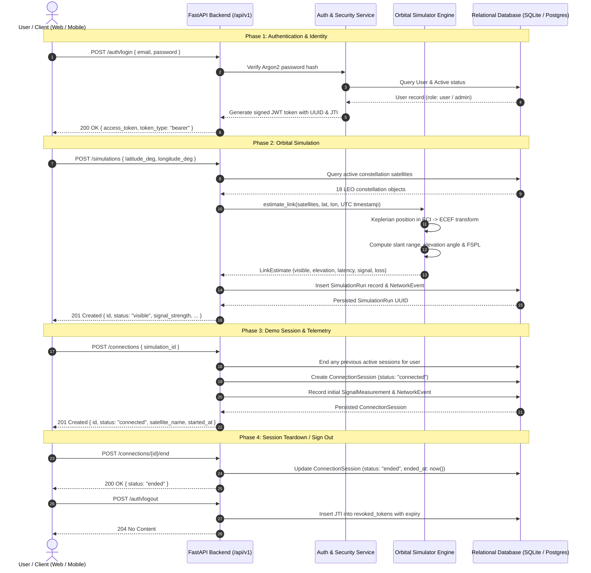

# SkyLink Direct — Application Workflow

This document illustrates the end-to-end data flows and user workflows across the SkyLink Direct prototype.

---

## Workflow Details

### 1. Registration and Authentication
- Clients authenticate against `/auth/login` or register with `/auth/register`.
- On successful authentication, a JWT is returned containing the user UUID in the `sub` claim and a unique UUID4 token ID in `jti`.
- Tokens are valid for 30 minutes. When `/auth/logout` is called, the `jti` is stored in the `revoked_tokens` table, invalidating any further use prior to expiration.

### 2. Visibility & Geometry Computation
- The simulation engine uses Kepler's Third Law ($n = \sqrt{\mu / a^3}$) and orbital elements (semi-major axis $a$, inclination $i$, RAAN $\Omega$, initial phase $M_0$) referenced to epoch 2024-01-01 UTC.
- Satellite coordinates in the orbital plane are rotated into Earth-Centered Inertial (ECI) frame, then rotated by Earth's diurnal rotation rate ($\omega_{\oplus} = 7.2921159 \times 10^{-5}\text{ rad/s}$) into Earth-Centered Earth-Fixed (ECEF) coordinates.
- The observer coordinates in ECEF and the local zenith vector $\hat{u}$ are derived from user latitude and longitude.
- Geometric elevation $El = \arcsin\left(\frac{\vec{\rho} \cdot \hat{u}}{\|\vec{\rho}\|}\right)$ determines visibility ($El > 0^\circ$).

### 3. Radio Link Heuristics
- **Free Space Path Loss (FSPL):** Calculated for 2.0 GHz S-band carrier frequency.
- **Received Power:** Derived from synthetic link budget ($P_{rx} = P_{tx} + G_{tx} - FSPL + G_{rx} - L_{misc}$).
- **Propagation Delay:** Slant range distance divided by speed of light ($c = 299,792\text{ km/s}$) for one-way, doubled for round-trip, plus 18 ms processing overhead.
- **Throughput & Loss:** Scaled with elevation angle factor ($\sin(El)$) to simulate link margin and modulation/coding scheme adjustments.

### 4. Connection Sessions
- Users start demonstration sessions linked to visible simulation runs or local coordinates.
- Multiple simultaneous sessions per user are avoided by automatically concluding older sessions.
- Signal measurements and network event logs provide an audit trail of session state.

