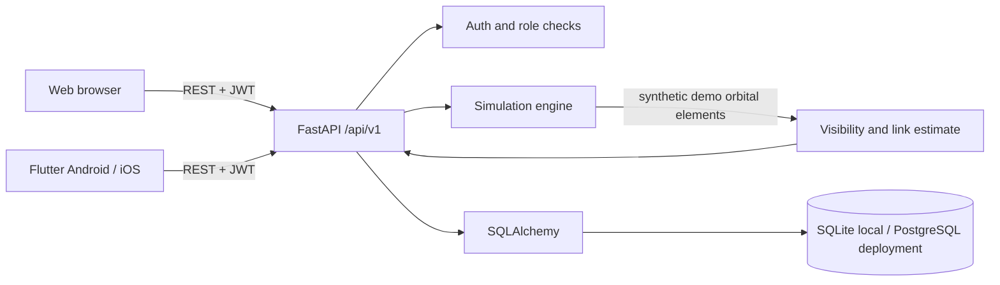

# Architecture

The API is the shared source of truth for account, satellite, simulation, connection, measurement, and ground station data. User-owned resources are filtered by authenticated user ID. Only accounts with the `admin` role can access administrative statistics. Public signup assigns `user`.

On startup, the backend creates missing ORM tables and idempotently seeds two roles (`user`, `admin`), an 18-satellite constellation across 6 orbital planes with phased RAAN and inclination, a demo ground station, and a default administrative account (`admin@skylink.direct`). The simulator computes geometric satellite positions and observer elevation, then applies illustrative link heuristics. It never reports live satellite service.

Local services are Vite (`localhost:5173` / `localhost:5174` with `/api/v1` reverse proxy), Uvicorn (`0.0.0.0:8000`), SQLite (`skylink.db`) or Compose PostgreSQL, and a Flutter client configured with an API base URL.

Before public deployment, use managed secrets and TLS, reviewed database migrations/backups, distributed rate limiting, a token lifecycle policy, monitoring, dependency review and abuse controls. Real satellite operations require external hardware, spectrum authorization and operator integration and are not implemented.
