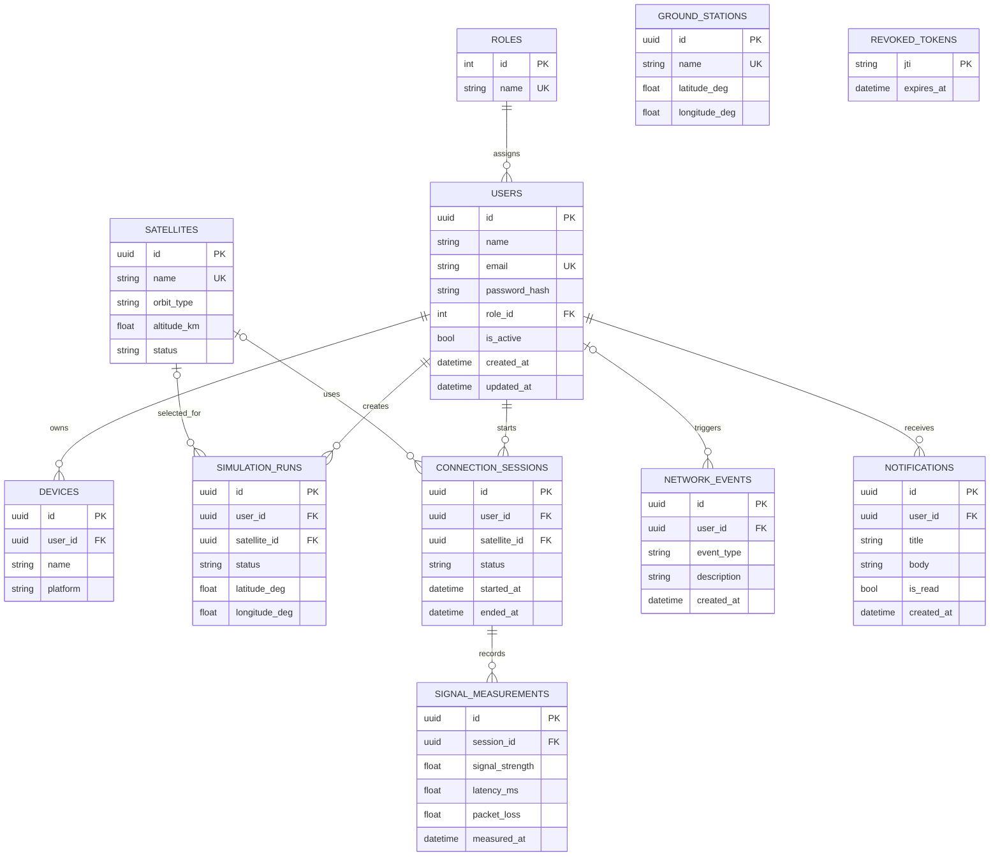

# Database ER diagram

UUID primary keys are used for user-owned and operational records. Emails and named reference entities are unique. Foreign keys enforce relationships; indexes cover user email, user simulation history, user session status, device owner and measurement time. Revoked JWT identifiers are stored until token expiry so logout can invalidate access.

Ground stations are managed via dedicated endpoints (`/api/v1/ground-stations`); notifications are modeled for downstream alert propagation.
