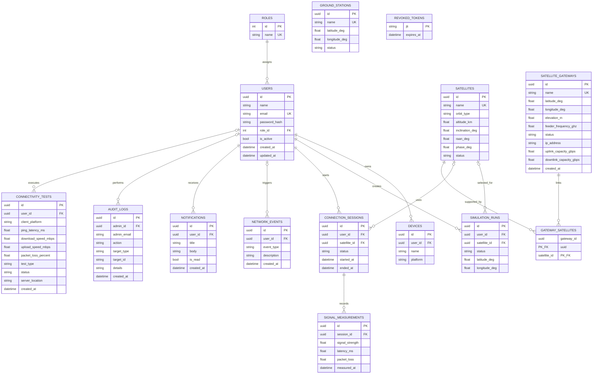

# Database ER diagram

UUID primary keys are used for user-owned, operational, and administrative records. Emails and named reference entities are unique. Foreign keys enforce relationships; indexes cover user email, user simulation history, user session status, device owner, measurement time, gateway feeder frequencies, connectivity test platform, and audit log creation time. Revoked JWT identifiers are stored until token expiry so logout can invalidate access.

Ground stations and satellite gateways are managed via dedicated endpoints (`/api/v1/ground-stations`, `/api/v1/admin/ground-stations`, and `/api/v1/gateways`); administrative actions automatically populate `AUDIT_LOGS` with target entity references and before/after mutation details.

### Newly Added Models (Phases 1 & 2):
1. **`SATELLITE_GATEWAYS`:**
   - Dedicated table for Earth teleport stations providing Ka-band (28.5–29.0 GHz) high-speed feeder links.
   - Stores geographic location (lat/lon/elevation), public egress IP, and uplink/downlink capacities in Gbps.
2. **`GATEWAY_SATELLITES`:**
   - Association table representing many-to-many feeder link connections between orbital satellites and ground teleports.
3. **`CONNECTIVITY_TESTS`:**
   - Records client internet performance benchmarks across mobile and web platforms (ping latency, download Mbps, upload Mbps, packet loss, server teleport location).
4. **`AUDIT_LOGS`:**
   - Tracks administrative actions and gateway modifications with timestamp, admin email, action type, and JSON details.
