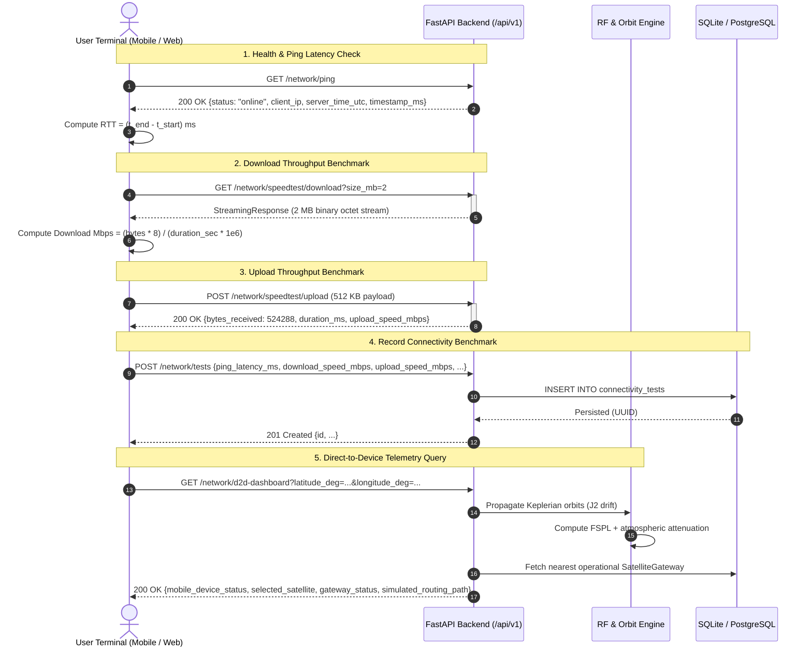

# Mobile-to-Server Data Flow & Benchmark Logic

## 1. Sequence Overview

This document illustrates the end-to-end data flow between the user terminals (Flutter mobile application and React web dashboard) and the FastAPI backend service.



---

## 2. Latency Measurement Logic

### Client-Side Round-Trip Time (RTT)
The round-trip time measures the elapsed time from socket request dispatch to full header receipt:

$$\text{RTT}_{\text{measured}} = t_{\text{response\_received}} - t_{\text{request\_dispatched}}$$

- **Flutter Implementation (`mobile/lib/main.dart`):**
  ```dart
  final stopwatch = Stopwatch()..start();
  final response = await http.get(Uri.parse('$baseUrl/network/ping'))
      .timeout(const Duration(seconds: 4));
  stopwatch.stop();
  final pingLatencyMs = stopwatch.elapsedMilliseconds.toDouble();
  ```
- **Web Implementation (`web/src/components/D2DDashboard.tsx`):**
  ```typescript
  const t0 = performance.now();
  await fetchJson('/network/ping');
  const pingMs = Math.round(performance.now() - t0);
  ```

### Simulated Satellite One-Way Slant Delay
In the simulation engine, one-way propagation latency across the slant distance $d$ (meters) is computed using the speed of light $c = 299,792,458\text{ m/s}$:

$$\tau_{\text{prop}} = \frac{d}{c} \times 1000\quad (\text{ms})$$

Total modeled satellite round-trip latency includes ground processing overhead $\tau_{\text{proc}} \approx 8.0\text{ ms}$:

$$\text{Latency}_{\text{sat\_rtt}} = 2 \times \tau_{\text{prop}} + \tau_{\text{proc}}$$

For a typical LEO satellite at 550 km altitude with slant range $750\text{ km}$:
$$\tau_{\text{prop}} \approx \frac{750,000}{299,792,458} \times 1000 \approx 2.50\text{ ms} \implies \text{Latency}_{\text{LEO}} \approx 2 \times 2.50 + 8.0 \approx 13.0\text{ ms}$$

---

## 3. Throughput Calculation Logic

### 3.1 Download Throughput
Controlled binary blocks of size $S_{\text{bytes}}$ are streamed using chunked transfer encoding with zero disk overhead:

$$\text{Throughput}_{\text{download}} = \frac{S_{\text{bytes}} \times 8}{(t_{\text{download\_end}} - t_{\text{download\_start}}) \times 10^6}\quad (\text{Mbps})$$

- Controlled block sizes range from $0.5\text{ MB}$ to $10.0\text{ MB}$.
- Default test size is $2.0\text{ MB} = 2,097,152\text{ bytes} = 16,777,216\text{ bits}$.

### 3.2 Upload Throughput
The client dispatches an in-memory synthetic octet array (e.g., $512\text{ KB}$) to `/api/v1/network/speedtest/upload`. Both client and server measure duration independently to eliminate client clock skew:

$$\text{Throughput}_{\text{upload}} = \frac{\text{Bytes Received} \times 8}{\Delta t_{\text{server}} \times 10^6}\quad (\text{Mbps})$$

---

## 4. Error Handling & Offline State Management

1. **Timeout Detection:**
   - Client requests are bound by strict socket timeouts ($4.0\text{ seconds}$ on mobile, $10.0\text{ seconds}$ on web).
   - If an endpoint fails to respond within the timeout interval, the client sets `online_status: "offline"`.
2. **Graceful Fallback:**
   - If the backend is unreachable (`net::ERR_CONNECTION_REFUSED`), the UI flags the server status and retains the last-known satellite coordinates rather than crashing.
3. **Automatic Token Expiry Handling:**
   - Expired JWT tokens (older than 24 hours) are purged silently on app initialization, redirecting the user cleanly to authentication without firing cascade 500/401 errors.

